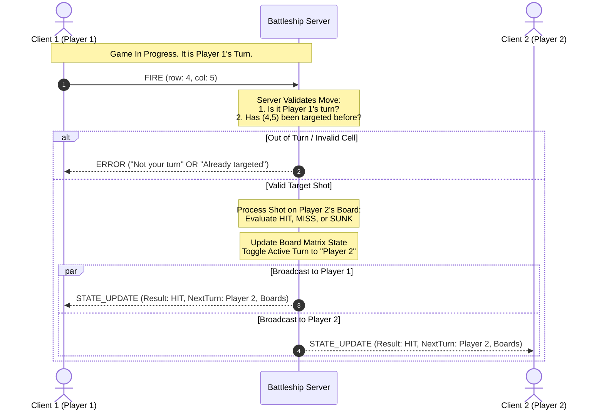

### Architecture Specifications
---
- **Concurrency Model**: Option A: Multi-Threading

A dedicated worker thread is spawned for each connected client connection socket. Shared memory structures (game state, board grid, client socket list) are protected using threading.Lock to prevent race conditions during state mutation.

### Connection Lifecycle
---
1. **Listening State**: The server listens for incoming TCP connections on a specified port. Upon accepting a connection, a new thread is spawned to handle the client.
2. **Accept & Handshake**: Client connects, main thread accepts the connection and assigns a unique client ID. 
3. **Client Registration**: The server reigsters the client in an active socket registry, spawning a dedicated worker thread, moving the client to that thread, off the main thread.
4. **Game Servicing**: Worker thread handles all incoming messages from the client, processes game logic, and sends state updates back to the client using the newline delimited JSON payloads. Shared state is accessed with locks to ensure thread safety.
5. **Socket Teardown**: A connection teardown is triggered by two events: (1) the client voluntarily disconnects, or (2) the server detects a timeout or error. The worker thread cleans up resources, removes the client from the active registry, and terminates.

### Thread Safety, Lock Acquisition & State Isolation
---
- **Shared Resources**:
    1. Game State (board matrices, player turns): Two 10x10 coordinate grids storing ship placements and hit/miss results.
    2. Active Client Socket Registry: List of active client sockets and their associated player IDs.
    3. Active Turn Tracker: A variable indicating which player's turn it is to make a move.
    4. Round Score Table: Memory structure tracking the number of hits, misses, and currently active ships for each player.

- **Locking Strategy**:
    To prevent concurrent data mutations from corrupting memory state, a `threading.Lock` is used to synchronize access to these shared resources. Each worker thread must acquire the lock before reading or writing to any of these shared structures, ensuring that only one thread can modify the game state at a time.

- **Lock Acquisition**:
    Turn Required Commands: Upon executing a command that requires turn validation (e.g., `MOVE`), the worker thread acquires the lock, checks if it is the active player's turn, processes the move, updates the game state, and releases the lock. If the turn cannot be validated, the thread sends an error message back to the client and releases the lock without modifying the state.

    Socket Transmissions: Socket transmissions are performed outside of the lock acquisition to prevent blocking other threads from accessing shared resources.

### Client Turn Diagram
---

